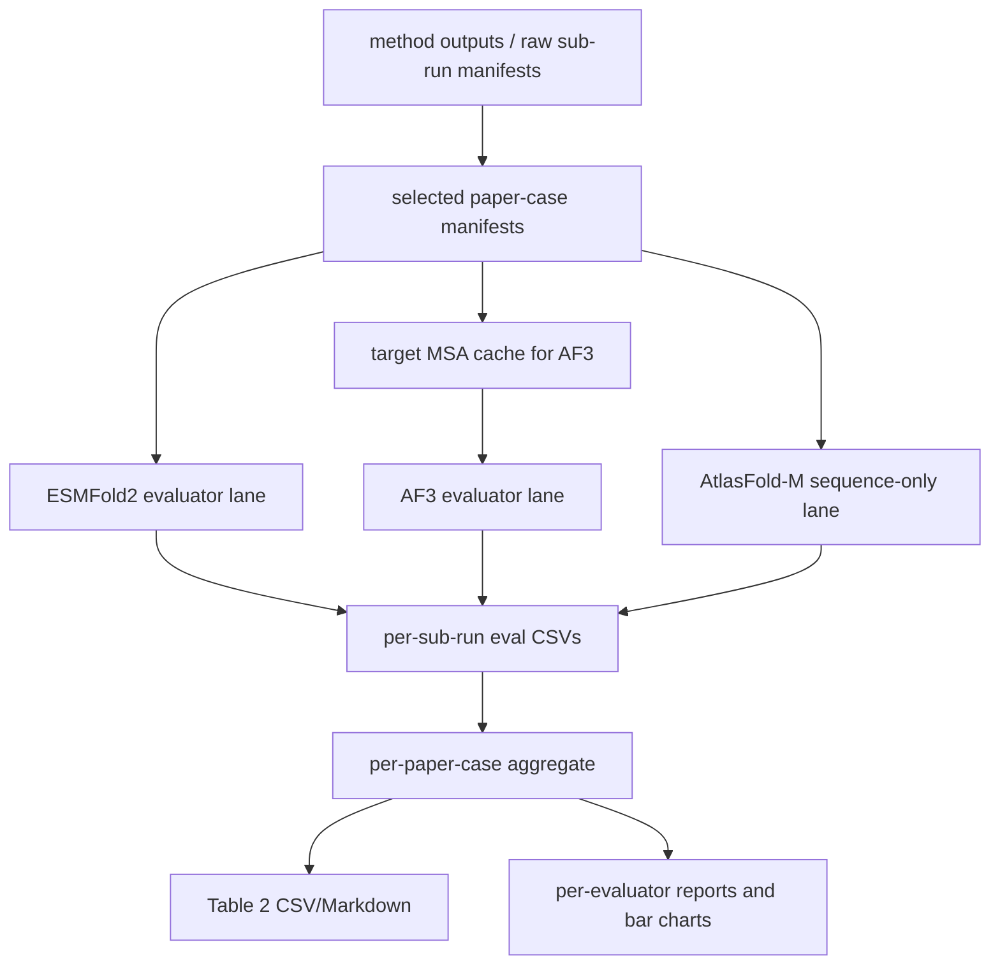

# ProteoCraft ESMFold2/AF3/AtlasFold-M Evaluator

## Independent stock ESMFold2 rescoring

From the repository root, `evaluation/metric_pipeline/run_esmfold2_rescore.py`
provides a standalone `prepare → run → report` workflow. It does not require an
optimization campaign. Use the Python 3.12 ProteoCraft ESMFold2 environment for
inference; preparation/reporting require only Python and PyYAML.

The versioned recipe is `configs/evaluation/esmfold2_official_rescore.yaml`:
all three optimization switches are explicitly **off**, both ESMFold2 and its
internal ESMC snapshots are pinned, and inference uses 20 loops / 200 sampling
steps with seeds 1043, 1044 and 1045. The evaluator uses official model weights
through the existing ProteoCraft adapter, not the separate Biohub SDK CLI.
`run` launches a fresh child process, rejects optimization autoload variables,
and requires the pinned models/CCD to exist in the Hugging Face cache. It never
downloads missing checkpoints. Search defaults and search outputs are untouched.

Input is JSONL, with one explicit candidate per line. Chain order, chain roles
and **zero-based indices into concatenated target sequences** are required:

```json
{"case_id":"example","candidate_id":"seed43-rank001","binder_seq":"ACDE","target_sequences":["AAAA","CCCC"],"target_chain_roles":["target","scaffold"],"target_hotspot_concat_indices":[0,3],"search_seed":43,"search_loss":0.4}
```

The short sequences above illustrate the schema, not a scientific test case.
Use `[]` explicitly for absent hotspots. Supply the entire binder sequence for
CDR/VHH designs. Extra JSON metadata, such as mutable masks or source identifiers,
is retained in the frozen manifest; it does not impose structural constraints.
This recipe performs **sequence-only refolding**, including for CDR/VHH. Template
or scaffold-constrained evaluation remains a separate protocol and is rejected
as a `structure_mode` here. Within one case ID, target sequences, roles and
hotspots must agree. Evaluation seeds may not equal a supplied search seed.

```bash
python evaluation/metric_pipeline/run_esmfold2_rescore.py prepare \
  --manifest candidates.jsonl --out-dir outputs/my_run/evaluation
python evaluation/metric_pipeline/run_esmfold2_rescore.py run \
  --out-dir outputs/my_run/evaluation --device cuda:0
python evaluation/metric_pipeline/run_esmfold2_rescore.py report \
  --out-dir outputs/my_run/evaluation
```

To select Top 5 unique sequences by lowest search `total_loss` from each completed
search, use `prepare --from-search --manifest completed_runs.jsonl`. Each input
row supplies `run_dir`, `candidate_prefix`, `case_id`, the same explicit target
context and optional `search_seed`; omit `binder_seq` and `candidate_id`:

```json
{"case_id":"example","candidate_prefix":"seed43","run_dir":"search/seed43","target_sequences":["AAAA"],"target_chain_roles":["target"],"target_hotspot_concat_indices":[],"search_seed":43}
```

Relative run paths resolve against the input manifest directory. A completed
`esmfold2_artifacts/run_summary.json` is required; when `experiment_run.json`
exists it must also report return code 0. Candidate deduplication is within each
run. Fewer than five unique candidates are retained as such, without padding.
For an explicit candidate manifest, all supplied candidates are evaluated;
Top K selection only applies with `--from-search`.

Outputs:

- `candidates.jsonl` and `evaluation_contract.json`: frozen sequences, contexts,
  protocol, selection provenance and hashes. Changed inputs/settings require a
  new output directory; the inference phase consumes only this frozen snapshot.
- `runtime_environment.json` and `optimization_report.json`: actual software,
  GPU, relevant source/config/CCD hashes, optimization settings and call counts.
  The source hashes cover the bounded scorer and geometry losses; the effective
  bounded and raw-common scoring weights are also recorded explicitly.
- `structures/<case>/<candidate>/seed_<seed>/esmfold2.cif` and `score.json`:
  structure and metrics per candidate/seed, or an explicit failure record.
- `scores.csv`: every expected candidate/seed, including failed or missing rows.
- `summary.csv`: mean/min/max/population SD; ranking within each case uses mean
  pair-chain iPTM and includes only candidates successful on **all** seeds.
  Hotspot coverage (8 Å and 5 Å), binder pLDDT (0–1), compactness and clash losses
  remain separate columns; ranking is not an experimental binding claim.
- `evaluation_status.json`: expected, successful, failed and missing counts.

Re-running resumes missing work and validates saved score identities and CIF
hashes. Failed attempts require `run --retry-failed`; their original records are
archived. Runtime/source changes cannot be mixed into an unfinished evaluation.
Receipts from before scorer hashes/weights were recorded cannot be resumed with
this version; use a new output directory, preserving the previous evaluation.
Incomplete candidates remain visible but receive no quality aggregate or rank.
The worker exits nonzero if any candidate/seed fails. A process lock prevents
concurrent writers to the same output directory.

For fast-vs-stock numerical comparisons at the search budget, copy the recipe
and set 4 loops / 50 sampling steps in a separate output directory. The default
20×200 final evaluation is a different protocol, not a direct numerical parity
test. Freeze the selection before comparing fast and stock searches.

BCv2  evaluation 代码目标：

- 将 method 产出的 binder design 统一整理成 manifest。
- 用当前 ProteoCraft ESMFold2 full verifier、AlphaFold 3 和 AtlasFold-M 评估 designs。
- AtlasFold-M 仅作为独立 sequence-only 交叉复评器，不参与搜索或候选排序。
- 保留 2026 年 5 月加入的 HuggingFace ESMFold evaluator 以复现旧结果。
- 汇总每个 paper case 的成功率、调用次数、运行时间和报告图表。
- 生成后续主实验表格需要的 `table2.csv` 和 `table2.md`。

## 1. 整体流程



典型执行顺序：

1. 从 method 输出构建 raw manifest。
2. 将 sub-run 合并/筛选成每个 paper case 一份 selected manifest。
3. 准备 AF3 target-only MSA cache。
4. 对每个 selected sub-run 跑 ESMFold2 evaluator。
5. 对每个 selected sub-run 跑 AF3 或 AtlasFold-M evaluator。
6. 运行 report 命令，生成 aggregate CSV、markdown report、Table 2 和图表。

## 2. 项目结构

```text
.
├── adapters/
│   ├── bcv1_adapter.py           # 将 BindCraft/BCv1 输出转换成 manifest rows
│   └── sub_run_aggregator.py     # 将 sub-runs 筛选/合并成 paper-case manifests
├── configs/
│   ├── bcv2_case_roster.json     # 预期 paper-case 列表，用于补 no-design stubs
│   └── target_templates.py       # 统一 target template 元数据
├── eval_pipeline/
│   ├── cli.py                    # evaluator 主入口，默认 esmfold2
│   ├── af3_runner.py             # AF3 input JSON、subprocess 调用、输出解析
│   ├── atlasfold_runner.py       # AtlasFold-M FASTA、版本检查、调用与输出解析
│   ├── esmfold2_runner.py        # 当前 ProteoCraft full-verifier adapter
│   ├── esmfold_runner.py         # 2026-05 legacy ESMFold wrapper
│   ├── manifest.py               # manifest schema 加载和校验
│   ├── metrics.py                # 结构指标和 confidence metrics
│   ├── report.py                 # 聚合、报告、Table 2、图表
│   └── tier_gating.py            # Tier-1 / Tier-2 pass flags
├── scripts/
│   ├── prepare_af3_target_msa.py # 为 AF3 构建 target MSA cache
│   ├── af3_smoke.sh              # 单 case AF3 smoke test helper
│   └── atlasfold_m_smoke.sh      # 单候选 AtlasFold-M GPU smoke helper
├── tests/                        # 单元测试和集成测试
├── vendor/                       # vendored Proteina-Complexa 工具代码
├── env_setup.sh                  # 可选 conda 环境初始化脚本
├── requirements.txt              # Python 依赖
└── pytest.ini
```

## 3. 环境准备

使用 Python 3.10。当前代码已经在下面这个集群 conda 环境中验证过：

```bash
/mnt/shared-storage-user/liyanchao/conda/miniconda3/envs/BindCraft/bin/python
```

如果从干净环境开始，也可以使用仓库内的初始化脚本：

```bash
bash env_setup.sh
conda activate esmfold-eval
```

Python 依赖见 `requirements.txt`。运行默认 `esmfold2` lane 时，应使用能够
加载 `biohub/ESMFold2` 的 ProteoCraft 主环境；独立的 `esmfold-eval` 环境仅
用于复现 `esmfold_202605`。其中比较关键的是：

- `biopython`
- `numpy`
- `pandas`
- `matplotlib`
- `tabulate`
- `zstandard`
- `torch`, `transformers`, `accelerate`，用于 ESMFold

运行测试时使用 `python -m pytest`，不要直接运行裸的 `pytest`。裸 `pytest` 可能解析到系统 Python，而不是当前 conda 环境。

如果要跑真实 AF3，需要在 Step 3 和 Step 5 前设置：

```bash
export AF3_PYTHON=/path/to/af3-env/bin/python
export AF3_RUN_SCRIPT=/path/to/alphafold3/run_alphafold.py
export AF3_MODEL_DIR=/path/to/dir/containing/af3.bin.zst
export AF3_DB_DIR=/path/to/af3-databases
```

`AF3_MODEL_DIR` 应该是包含 `.bin.zst` 模型权重的目录，不是模型文件本身。

AtlasFold-M 必须使用独立环境和完整的官方源码 checkout。固定源码、环境安装、权重
receipt 和自检命令见 [`environment/atlasfold/README.md`](../../environment/atlasfold/README.md)。
正式运行前设置：

```bash
export ATLASFOLD_PYTHON=/path/to/proteocraft_atlasfold_m_py312/bin/python
export ATLASFOLD_SOURCE_ROOT=/path/to/atlasfold-v1.0.2
export ATLASFOLD_CACHE_DIR=/path/to/atlasfold_cache
export ATLASFOLD_MODEL_PATH=/path/to/weights/atlasfold-m-260725.pth
export ATLASFOLD_LM_PATH=/path/to/weights/atlaslm_3b_base.pth
export ATLASFOLD_WEIGHTS_RECEIPT=/path/to/atlasfold_m_weights_receipt.json
```

## 4. 输入约定

### 4.1 现有 BindCraft/BCv1 输出

当前 adapter 面向 BindCraft-style batch outputs，会把它们转换成 evaluator 可读取的 manifest CSV：

```bash
python -m adapters.bcv1_adapter \
  --batch-dir /path/to/BindCraft/outputs/batch_v1 \
  --case PD1 \
  --out work/manifests/PD1.raw.manifest.csv
```

对于当前 BCv2 paper-case 设置，raw sub-run 包括 `PD1` 这类单 run case，也包括 `DerF21_h17`、`DerF21_h35` 这类多 sub-run case。

### 4.2 新 method 输出

如果后续要接入其他 method，evaluator 最终需要的是“每个 accepted design 一行”的 manifest。method 原始输出至少要保留足够信息，以便构建下面这些字段：

| Field                         | 含义                                                             |
| ----------------------------- | ---------------------------------------------------------------- |
| `method`                    | method 名称，例如 `BCv1`, `BCv2`, `RFdiff`, `PXDesign-h` |
| `case`                      | sub-run/case 名称，例如 `DerF21_h17`                           |
| `paper_case`                | paper-level case，例如 `DerF21`                                |
| `design_id`                 | design 唯一 ID，应该和 PDB 文件 stem 一致                        |
| `target_seq`                | target 序列；多链 target 用 `:` 分隔                           |
| `target_chain_roles`        | 可选；按链填写 `target`/`scaffold`，CDR 任务用于排除 scaffold |
| `target_hotspot_concat_indices` | 可选；拼接 target 序列上的零基 hotspot indices             |
| `binder_seq`                | binder 序列                                                      |
| `designed_complex_pdb_path` | complex PDB 路径，需包含 target 和 binder chains                 |
| `target_chain_in_complex`   | reference complex 里的 target chain IDs，多链写成 `D+E`        |
| `binder_chain_in_complex`   | reference complex 里的 binder chain ID                           |
| `n_generated_trajectories`  | denominator 统计用，总共尝试的 candidates 数                     |
| `n_accepted_by_method`      | method 自己筛选后接受的 designs 数                               |
| `candidate_rank`            | accepted designs 中的 rank，如果有                               |
| `verifier_calls`            | method 内部 verifier 调用次数                                    |
| `design_gpu_seconds`        | method 侧 GPU 用时，如果有                                       |

其中 denominator 相关字段很重要：`n_generated_trajectories`、`n_accepted_by_method`、`verifier_calls` 和 `design_gpu_seconds` 如果运行时没有记录，事后很难可靠重建。

每个 design PDB 应该包含 target chain(s)、单一 binder chain、标准 ATOM records，并且 chain IDs 要和 manifest 一致。BCv1-style cases 通常 target 是 chain `A`、binder 是 chain `B`；TCR cases 可能有多个 target chains，例如 `D+E`。

## 5. 如何运行 evaluation

下面的例子假设当前在 `evaluation/metric_pipeline/` 目录下，并使用 `work/` 作为运行输出目录：

```bash
cd <BindCraft-v2-root>/evaluation/metric_pipeline
mkdir -p work/manifests
```

### Step 1: 构建 raw sub-run manifests

以 BCv1/BindCraft batch 为例：

```bash
for sub_run in PD1 PDL1 IFNAR2 SpCas9 \
               BetV1_h23 BetV1_h24 \
               DerF7_h132 DerF7_h178 \
               DerF21_h17 DerF21_h35 DerF21_h70 DerF21_h88 DerF21_h99 \
               HER2_h148 HER2_h143_148 \
               TCR_1QRN TCR_3QDJ TCR_5BS0 TCR_6BJ8 TCR_9C3E; do
  python -m adapters.bcv1_adapter \
    --batch-dir /path/to/BindCraft/outputs/batch_v1 \
    --case "$sub_run" \
    --out work/manifests/${sub_run}.raw.manifest.csv
done
```

### Step 2: 生成 selected paper-case manifests

```bash
python -m adapters.sub_run_aggregator \
  --sub-run-manifests work/manifests/*.raw.manifest.csv \
  --bindcraft-outputs /path/to/BindCraft/outputs/batch_v1 \
  --out-dir work/
```

输出：

```text
work/manifests/<paper_case>.selected.manifest.csv
```

OR-merge cases 会在同一份 selected manifest 中保留多个 sub-runs，同时保留 `paper_case`，供后续按 paper case 聚合。

### Step 3: 准备 AF3 target MSA cache

AF3 evaluation 前运行一次：

```bash
python scripts/prepare_af3_target_msa.py \
  --manifest work/manifests/*.selected.manifest.csv \
  --work-root work/ \
  --af3-python "$AF3_PYTHON" \
  --af3-run-script "$AF3_RUN_SCRIPT" \
  --af3-model-dir "$AF3_MODEL_DIR" \
  --af3-db-dir "$AF3_DB_DIR"
```

输出：

```text
work/per_paper_case_msa/<paper_case>/target_chain_<id>.a3m
```

完整 cache 在 rerun 时会自动跳过。这里 target-chain 顺序有语义，脚本会按顺序检查一致性。

### Step 4: 运行默认 ESMFold2 lane

默认评价器直接复用 ProteoCraft 搜索所使用的 full verifier，默认配置为
`biohub/ESMFold2`、`20 × 200`、seed 43 和 `aligned_common` loss：

```bash
for paper_case in PD1 PDL1 IFNAR2 BetV1 DerF7 DerF21 HER2 SpCas9 \
                  TCR_1QRN TCR_3QDJ TCR_5BS0 TCR_6BJ8 TCR_9C3E; do
  selected=work/manifests/${paper_case}.selected.manifest.csv
  for sub_run in $(awk -F, 'NR>1 {print $2}' "$selected" | sort -u); do
    python -m eval_pipeline.cli \
      --manifest "$selected" \
      --out-dir work/ \
      --evaluator esmfold2 \
      --paper-case "$paper_case" \
      --sub-run "$sub_run"
  done
done
```

输出：

```text
work/eval/<paper_case>__<sub_run>__esmfold2.csv
```

复现旧评估时显式使用 `--evaluator esmfold_202605`。`--evaluator esmfold`
仍作为兼容别名保留，但会输出弃用提示。

### Step 5: 运行 AF3 lane

AF3 建议一个 sub-run 一个任务提交。示例：

```bash
python -m eval_pipeline.cli \
  --manifest work/manifests/<PAPER_CASE>.selected.manifest.csv \
  --out-dir work/ \
  --evaluator af3 \
  --paper-case <PAPER_CASE> \
  --sub-run <SUB_RUN> \
  --af3-python "$AF3_PYTHON" \
  --af3-run-script "$AF3_RUN_SCRIPT" \
  --af3-model-dir "$AF3_MODEL_DIR" \
  --af3-db-dir "$AF3_DB_DIR"
```

输出：

```text
work/eval/<paper_case>__<sub_run>__af3.csv
```

文件名始终使用三段命名，包括 `paper_case == sub_run` 的情况，例如 `PD1__PD1__af3.csv`。

### Step 5b: 运行 AtlasFold-M 独立复评

AtlasFold-M 使用官方 `atlasfold multimer` sequence-only 路径。输入顺序固定为
manifest 中的 target/scaffold chains，最后一条是 binder；输出会按同样顺序映射为
`A, B, C, ...`。示例：

```bash
python -m eval_pipeline.cli \
  --manifest work/manifests/<PAPER_CASE>.selected.manifest.csv \
  --out-dir work/ \
  --evaluator atlasfold_m \
  --paper-case <PAPER_CASE> \
  --sub-run <SUB_RUN> \
  --atlasfold-python "$ATLASFOLD_PYTHON" \
  --atlasfold-source-root "$ATLASFOLD_SOURCE_ROOT" \
  --atlasfold-cache-dir "$ATLASFOLD_CACHE_DIR" \
  --atlasfold-model-path "$ATLASFOLD_MODEL_PATH" \
  --atlasfold-lm-path "$ATLASFOLD_LM_PATH" \
  --atlasfold-weights-receipt "$ATLASFOLD_WEIGHTS_RECEIPT"
```

默认值与 AtlasFold-M v1.0.2 官方 multimer CLI 一致：10 recycles、MLM probability
0.20、1 个 seed、每个 seed 5 个 diffusion samples、200 diffusion steps。适配器保存
全部官方样本输出，并按官方 ranking score 选出 ranked sample 进入统一指标流水线。

主要指标口径：

- `atlasfold_pair_chain_iptm` / `pair_chain_iptm`：所有 role=`target` 的链分别与
  binder 的 interface ipTM 均值。
- `atlasfold_scaffold_pair_chain_iptm`：role=`scaffold` 的链与 binder 的 interface
  ipTM 均值，不混入主 Pair iPTM。
- `atlasfold_iptm`、`atlasfold_ptm`、`atlasfold_ranking_score`：AtlasFold-M 官方
  complex-level native metrics。
- `atlasfold_interface_iptm_json`：完整 chain-pair interface map，避免聚合后丢失信息。

该 lane 不接收 template，也不使用 AtlasFold-M 分数更新 ProteoCraft 搜索。当前尚未
为 AtlasFold-M 校准 ProteoCraft Tier-1/Tier-2 阈值，因此 tier flags 固定为 false，
正式比较应直接报告 native metrics 和成对排序一致性。

`designed_complex_pdb_path` 对 AtlasFold-M 只用于可选的 scRMSD 参考，不进入模型。
该字段为空时仍正常完成 sequence-only 复评；为 PDB 或 mmCIF 时会额外计算 scRMSD，
并在 `atlasfold_reference_metric_status` 中记录 `computed`、`missing` 或 `failed`。

部署后先用一个候选做 10-step GPU smoke（只验证完整链路，不作为正式结果）：

```bash
PROTEOCRAFT_PYTHON=/path/to/proteocraft/python \
  bash scripts/atlasfold_m_smoke.sh \
  work/manifests/PD1.selected.manifest.csv \
  work/atlasfold_smoke PD1 PD1 cuda:0
```

预期 paper-case/sub-run 矩阵：

| paper_case | sub_run(s)                                                                     |
| ---------- | ------------------------------------------------------------------------------ |
| PD1        | PD1                                                                            |
| PDL1       | PDL1                                                                           |
| IFNAR2     | IFNAR2                                                                         |
| SpCas9     | SpCas9                                                                         |
| BetV1      | aggregator 会从 `BetV1_h23` 或 `BetV1_h24` 中选择一个                      |
| DerF7      | `DerF7_h132`, `DerF7_h178`                                                 |
| DerF21     | `DerF21_h17`, `DerF21_h35`, `DerF21_h70`, `DerF21_h88`, `DerF21_h99` |
| HER2       | `HER2_h148`, `HER2_h143_148`                                               |
| TCR_1QRN   | `TCR_1QRN`                                                                   |
| TCR_3QDJ   | `TCR_3QDJ`                                                                   |
| TCR_5BS0   | `TCR_5BS0`                                                                   |
| TCR_6BJ8   | `TCR_6BJ8`                                                                   |
| TCR_9C3E   | `TCR_9C3E`                                                                   |

查看某个 selected manifest 中实际有哪些 sub-runs：

```bash
awk -F, 'NR>1 {print $2}' work/manifests/DerF21.selected.manifest.csv | sort -u
```

### Step 6: 汇总报告

```bash
python -m eval_pipeline.report \
  --auto-discover \
  --case-roster configs/bcv2_case_roster.json \
  --evaluators esmfold2 af3 \
  --out-dir work/ \
  --run-id bcv2_table2
```

这个命令读取 `work/eval/*.csv`，并把最终报告输出写到 `work/` 下。

## 6. 输出文件说明

| Path                                               | 用途                                                          |
| -------------------------------------------------- | ------------------------------------------------------------- |
| `work/eval/<paper_case>__<sub_run>__esmfold2.csv` | 当前 ESMFold2 full-verifier metrics                         |
| `work/eval/<paper_case>__<sub_run>__esmfold_202605.csv` | 旧 ESMFold evaluator metrics                        |
| `work/eval/<paper_case>__<sub_run>__af3.csv`     | 单个 sub-run 的 per-design AF3 metrics                        |
| `work/eval/<paper_case>__<sub_run>__atlasfold_m.csv` | 单个 sub-run 的 AtlasFold-M metrics                      |
| `work/atlasfold_outputs/<paper_case>/<sub_run>/` | AtlasFold-M 全部官方原始样本、confidence 与 done markers   |
| `work/per_design/<method>/<case>/<design_id>/atlasfold_m/` | 统一命名的 ranked CIF/PDB、arrays 和 provenance |
| `work/eval_per_paper_case_aggregate.csv`         | 按 evaluator、method、paper case 聚合的主结果表               |
| `work/table2.csv`                                | wide format Table 2 CSV，列名形如 `method_evaluator_metric` |
| `work/table2.md`                                 | Markdown 版 Table 2                                           |
| `work/report_esmfold2.md`                        | 当前 ESMFold2 lane 报告                                      |
| `work/report_af3.md`                             | AF3 lane 报告；如果有 AF3 native metrics，会单独汇总          |
| `work/report_atlasfold_m.md`                     | AtlasFold-M 原生指标和未校准状态说明                         |
| `work/bar_chart_esmfold2.png`                    | ESMFold2 各 paper case pass-rate 图                           |
| `work/bar_chart_af3.png`                         | AF3 各 paper case pass-rate 图                                |
| `work/bar_chart_atlasfold_m.png`                 | AtlasFold-M 未校准提示图，不伪造 pass-rate                    |

使用 `configs/bcv2_case_roster.json` 和 `--evaluators esmfold2 af3` 时，aggregate 预期有 26 行：13 个 paper cases 乘以 2 个 evaluators。没有 accepted designs 的 case 会以 `_NO_DESIGNS` stub 表示，calls 和 successes 为 0；图里会标成 `no designs`，不会当成真实 0% pass rate。

`eval_per_paper_case_aggregate.csv` 中几个关键列：

| Column                   | 含义                                                             |
| ------------------------ | ---------------------------------------------------------------- |
| `evaluator`            | `esmfold2`、`esmfold_202605` 或 `af3`                       |
| `method`               | method 名称                                                      |
| `paper_case`           | paper-level case                                                 |
| `n_designs_evaluated`  | 实际被 evaluator 评估的 designs 数                               |
| `n_calls`              | evaluator 调用次数                                               |
| `n_successes`          | evaluator 成功 rows 数                                           |
| `success_rate`         | `n_successes / n_designs_evaluated`                            |
| `eval_runtime_s_total` | evaluator 总运行时间                                             |
| `tier1_rate`           | evaluated designs 上的 Tier-1 pass 平均值；no-design stub 为 NaN |
| `tier2_rate`           | evaluated designs 上的 Tier-2 pass 平均值；no-design stub 为 NaN |

## 7. Rerun 和断点恢复

`--skip-existing` 默认开启。

- 重跑单个 ESMFold design：删除 `work/per_design/<method>/<case>/<design_id>/esmfold.pdb`，然后重跑对应 sub-run。
- 重跑单个 AF3 design：删除 `work/per_design/<method>/<case>/<design_id>/af3/af3_pred.pdb`，然后重跑对应 sub-run。
- 重跑单个 AF3 sub-run：删除 `work/staging/<paper_case>/<sub_run>/` 和 `work/af3_outputs/<paper_case>/<sub_run>/`，然后重跑。
- 重跑单个 AtlasFold-M design：删除对应 `per_design/.../atlasfold_m/atlasfold_m.cif`
  和 eval CSV 中该 design 的行，或对 sub-run 使用 `--no-skip-existing`。
- AtlasFold-M 会保留官方 `done.txt` 输出用于进程中断后的恢复；如果已有输出的参数或
  环境 provenance 与当前运行不一致，会拒绝混用并要求显式 `--no-skip-existing`。
- 强制重建：传入 `--no-skip-existing`。

evaluator 会增量写 CSV。如果某个 sub-run 中途失败，先检查对应 `work/eval/*.csv` 里的 `error_msg`，修复底层问题后再 rerun。

如果没有真实 AF3 安装，可以用 mock mode 做本地 smoke test：

```bash
AF3_MOCK=1 bash scripts/af3_smoke.sh work/manifests/PD1.selected.manifest.csv /tmp/af3_smoke
```

真实 AF3 的单 design smoke test：

```bash
bash scripts/af3_smoke.sh work/manifests/PD1.selected.manifest.csv work/smoke
```

## 8. 验证

推荐 CPU/regression 测试命令：

```bash
PYBIN=/mnt/shared-storage-user/liyanchao/conda/miniconda3/envs/BindCraft/bin/python
$PYBIN -m pytest tests/ --ignore=tests/test_esmfold_runner.py -q -rs
```

当前交接环境中的最近验证结果：

```text
161 passed, 2 skipped
```

预期 skipped tests：

- 当前 evaluator env 没有安装真实 `alphafold3` Python package 时，会跳过 AF3 import validation。
- 如果本地没有可选的 BCv1 PDL1 fixture，会跳过一个相关 fixture test。

AtlasFold-M adapter 的 CPU mock 集成测试不加载权重：

```bash
python -m pytest tests/test_atlasfold_runner.py -q
```

ESMFold GPU tests 只建议在有合适 GPU 显存和模型 cache 的节点上单独运行：

```bash
$PYBIN -m pytest tests/test_esmfold_runner.py -v -s
```

## 9. 实际运行注意事项

- AF3 preflight 会在启动真实 AF3 前检查 target MSA 是否存在，以及 target-chain CA 数量是否和 `target_seq` 一致；单链 target 也会检查。
- AF3 output parser 支持 `.cif` 和 `.cif.zst`；如果 AF3 输出压缩文件，环境里必须安装 `zstandard`。
- ESMFold multimer evaluation 可以作为统一 baseline，但对 docking/interface quality 可能比较苛刻。strict pass rate 很低时，不应直接理解成 method 一定失败。
- TCR cases 更复杂，因为 target 可能是 alpha/beta 多链，而不是单链。大规模运行前需要确认 `target_chain_in_complex` 和 `target_seq` 顺序。
